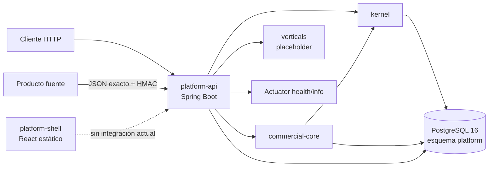
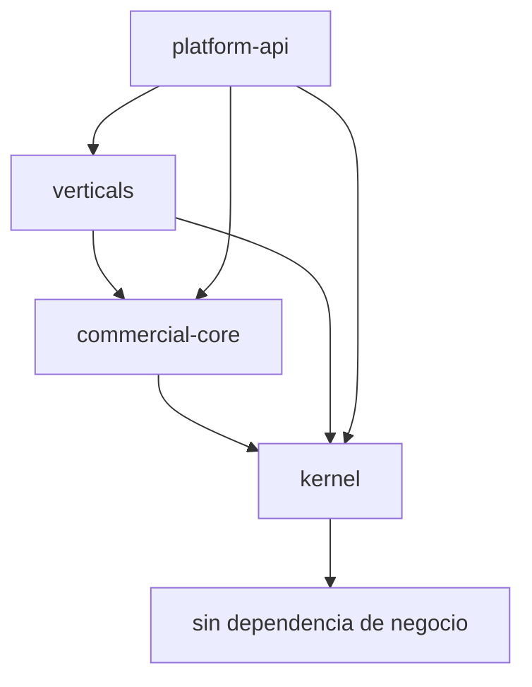

# Sistema, arquitectura y mapa del repositorio

**Verificado:** 2026-07-24 contra `85b1caf48c18633dd77459505e52410fdc9072d8`.

> La documentación es una guía secundaria. Antes de modificar el proyecto, verificar siempre el estado actual del código, las pruebas, la configuración y las referencias reales.

## Propósito y límites funcionales

Jere Platform provee una base técnica común para productos SaaS verticales sin duplicar tenancy, identidad, autorización, auditoría, confiabilidad, infraestructura local y componentes UI. No es un ERP genérico ni una colección de microservicios.

Actores identificables en el código actual:

- administrador inicial de plataforma, mediante bootstrap único;
- identidad autenticada con una o más memberships tenant-scoped;
- usuario con roles y permisos efectivos por tenant y, cuando corresponde, sucursal;
- operador autorizado para consultar auditoría, confiabilidad y referencias comerciales;
- producto fuente que entrega artefactos firmados de referencias.

Capacidades implementadas:

- bootstrap transaccional único;
- tenancy, organizaciones, sucursales y memberships;
- credenciales, login, access JWT, refresh rotation, logout y revocación;
- RBAC, entitlements y feature flags separados;
- auditoría append-only, idempotencia y outbox PostgreSQL;
- directorio de referencias comerciales y reconciliación;
- ingestión HMAC de exportaciones party-source;
- health/info Actuator;
- shell React estático y contratos TypeScript.

Fuera de alcance actual: lógica vertical, UI funcional, cliente API frontend, recuperación de credenciales, MFA, rate limiting, producción, backups, broker, almacenamiento de objetos, notificaciones y OpenAPI.

## Arquitectura actual

La dirección de dependencias está protegida por `ModuleArchitectureTest`:

- `kernel` no depende de `commercial` ni `verticals`;
- `commercial` no depende de `verticals`;
- módulos de dominio no dependen de `platform`;
- paquetes `kernel..internal` y `commercial..internal` permanecen encapsulados.

## Mapa explicativo del repositorio

| Ruta | Responsabilidad | Puntos de entrada o precauciones |
|---|---|---|
| `backend/pom.xml` | Reactor Maven, versiones y plugins comunes | Cambiar versiones afecta todos los módulos. Java admitido: `[21,22)`. |
| `backend/platform-api/` | Deployable Spring Boot y adaptadores HTTP | No debe convertirse en dueño de reglas de negocio. |
| `backend/platform-api/src/main/java/com/jereplatform/platform/PlatformApplication.java` | Bootstrap Java | `PlatformApplication.main()`; escanea `com.jereplatform`. |
| `backend/platform-api/src/main/resources/application.yml` | Configuración runtime | Flyway valida esquema; no agregar secretos. |
| `backend/platform-api/src/main/resources/db/migration/` | Migraciones Flyway V1-V8 | Forward-only. No editar una migración publicada; agregar una nueva. |
| `backend/modules/kernel/` | Tenancy, identidad, autorización y confiabilidad | Expone contratos `api`/`application`; `internal` no se importa desde fuera. |
| `backend/modules/commercial-core/` | Referencias comerciales compartidas | Depende de contratos públicos del kernel; no contiene perfiles verticales. |
| `backend/modules/verticals/` | Límite para verticales futuras | Actualmente marker/placeholder; no presentar como funcionalidad existente. |
| `backend/platform-api/src/test/` | Integración PostgreSQL, contratos y arquitectura | Fuente principal de invariantes de seguridad y concurrencia. |
| `frontend/package.json` | Workspace npm y gates | `check` sincroniza permisos, lint, typecheck y tests. |
| `frontend/apps/platform-shell/` | Shell React estático | No tiene login, routing, selección de tenant ni llamadas API. |
| `frontend/packages/ui/` | UI compartida mínima | No es todavía un design system. |
| `frontend/scripts/verify-permission-contract.mjs` | Contrato de permisos | Debe seguir sincronizado con JSON, Java y TypeScript. |
| `contracts/authorization/` | Contrato canónico de permisos | Cambio coordinado y versionado. |
| `contracts/parties/` | Source types, schema y fixtures sintéticas | No incorporar datos reales ni perfiles completos. |
| `infra/compose.yaml` | PostgreSQL local | No representa infraestructura productiva. |
| `scripts/validate.*` | Validación integral soportada | PowerShell corta ante cualquier `$LASTEXITCODE` no cero. |
| `scripts/smoke-gestudio-source-export.ps1` | Smoke cross-repository local | Requiere repo Gestudio limpio; no es evidencia de producción. |
| `.github/workflows/ci.yml` | CI de backend, frontend y secretos | Se ejecuta en PR y push a `main`. |
| `.github/dependabot.yml` | Updates semanales minor/patch | Majors ignorados deliberadamente; requieren trabajo explícito. |
| `docs/adr/` | Decisiones durables | No duplicar ni reinterpretar una decisión aceptada sin ADR. |
| `docs/analysis/` | Evidencia y análisis de fuentes | Contexto histórico; verificar actualidad. |
| `docs/assistant-reference/` | Esta autorreferencia | Resumen secundario, no fuente primaria. |

## Archivos generados o locales que no deben editarse/versionarse

Según `.gitignore`: `target/`, `build/`, `node_modules/`, `dist/`, `coverage/`, `.vite/`, `*.tsbuildinfo`, logs, reportes de pruebas, `.env*` excepto `.env.example`, llaves/certificados, dumps, backups, uploads y storage locales.

El lockfile `frontend/package-lock.json` sí es fuente versionada. No editar hashes manualmente; regenerarlo solo con un cambio legítimo de dependencias usando Node/npm soportados.

## Puntos de entrada y ciclo de ejecución

1. `PlatformApplication.main()` inicia Spring Boot.
2. `application.yml` configura datasource, Flyway, seguridad, Actuator y shutdown graceful.
3. Flyway crea/valida el esquema `platform`; Hibernate usa `ddl-auto: validate` y `open-in-view: false`.
4. `AuthenticationRuntimeConfiguration` crea `PasswordEncoder`, `Clock`, política de sesiones y `JwtTokenService`.
5. `ApiSecurityConfiguration.apiSecurityFilterChain()` configura una API stateless.
6. `AccessTokenAuthenticationFilter` valida el bearer y el estado vigente de sesión.
7. `TenantContextFilter.doFilterInternal()` abre el contexto tenant confiable, propaga correlación y lo limpia al finalizar.
8. Los controladores de `platform-api` delegan en servicios de `kernel` o `commercial-core`.
9. Las transacciones persisten en PostgreSQL; los side effects externos deben quedar en outbox.
10. El proceso acepta shutdown graceful por configuración del servidor.

No existe worker programado o proceso separado configurado en el repositorio. `OutboxWorker` es invocable, pero no hay dispatcher externo ni scheduler productivo.

## Fronteras entre módulos

Formas permitidas:

- interfaz pública de aplicación del módulo dueño;
- contrato inmutable público;
- evento interno de un hecho ya completado;
- proyección explícita de lectura.

Formas prohibidas:

- importar `internal` de otro módulo;
- compartir entidades JPA mutables;
- consultar tablas ajenas directamente;
- introducir ciclos;
- aceptar tenant arbitrario cuando existe `TenantContext` confiable.

## Topología y despliegue

La única infraestructura ejecutable es PostgreSQL local mediante Compose. `docs/architecture/target-architecture.md` describe una topología objetivo, no el estado implementado.

**No existe evidencia en el repositorio** de:

- imagen Docker de la aplicación;
- reverse proxy;
- hosting o dominio productivo;
- IaC;
- estrategia de rollback de runtime;
- backup/restore;
- alertas, dashboard o tracing;
- despliegue automatizado.

## Pruebas relacionadas

- `ModuleArchitectureTest`
- `PlatformApplicationIT`
- `TenantBoundaryIT`
- `AuthenticationLifecycleIT`
- `AuthorizationIntegrationIT`
- `ReliabilityIntegrationIT`
- `PartyReferenceIntegrationIT`

Volver al [índice](README.md).
